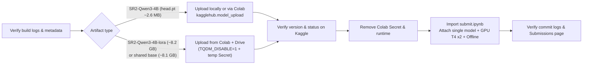

# Agent Workflow: Model Publishing and Kaggle Submission

[Documentation index](../README.md) · [Kaggle submission notebook](kaggle-submission.md) · [Colab setup](colab.md)

This guide defines the standard workflow for publishing trained builds (`SR2-Qwen3-4B` and `SR2-Qwen3-4B-lora`) from local storage or Google Drive to Kaggle Models and submitting to the competition.

## Overview



## 1. Pre-upload checks and auth boundaries

1. **Match the build to its preset:** When [`scripts/build.py`](../scripts/build.py) runs multiple configs sequentially, local `models/` outputs are overwritten by the last run, while Drive `build-<timestamp>/` backups keep every run. Inspect [`results/logs/build-*.log`](../results/logs/) or check `created_at`, `pooling`, `head_architecture`, and `training_config.build_min_lr` inside `head.pt` / `adapter.pt` metadata against [`configs/`](../configs/).
2. **Respect `KAGGLE_API_TOKEN` scope:** The root `.env` token works for `kagglehub.whoami()` and `kagglehub.model_upload(...)`, but `kagglesdk` kernel/submission endpoints return `401 Unauthorized`. **Upload models via `kagglehub`, and handle notebook import, input attachment, and submission in the Kaggle web UI.**

## 2. Publish models to Kaggle Models

Kaggle's web uploader cannot mount Google Drive, competition submissions run offline (`Internet: Off`), and the public `Skywork/Skywork-Reward-V2-Qwen3-4B` handle on Kaggle hosts no weights. Upload to private Kaggle Model handles (`<owner>/<model-slug>/transformers/default`):

| Target handle | Contents | Upload strategy |
| :--- | :--- | :--- |
| `dnbide/skywork-reward-v2-qwen3-4b/transformers/default` | Frozen base snapshot (~`8.06 GB`) | Upload once from Colab with `ignore_patterns=["assets/", ".gitattributes"]` |
| `dnbide/sr2-qwen3-4b/transformers/default` | `SR2_Qwen3_4B/head.pt` (~`2.63 MB`) | Upload locally (preserving `SR2_Qwen3_4B/head.pt`) or from Colab |
| `dnbide/sr2-qwen3-4b-lora/transformers/default` | `SR2_Qwen3_4B_lora/` (`adapter.pt` + `merged/`, ~`8.19 GB`) | Upload from Colab with Drive mounted to avoid local bandwidth transfer |

### Colab cloud upload rules

1. **Pass credentials via Colab Secrets:** Browser automation blocks file-picker uploads on `colab.research.google.com`. Add `KAGGLE_API_TOKEN` temporarily in Colab's **Secrets** panel, enable notebook access, and clear it in `finally: os.environ.pop("KAGGLE_API_TOKEN", None)`. **Never print tokens in outputs/logs or save credentialed scratchpads to Drive.**
2. **Disable `tqdm` before importing `kagglehub`:** High-frequency progress bars during multipart uploads can freeze the Colab DOM. Always set `os.environ["TQDM_DISABLE"] = "1"` before `import kagglehub`.
3. **Never upload concurrently to the same slug:** `kagglehub.model_upload` auto-increments `V1`, `V2`, `V3`. Concurrent uploads to the same handle risk out-of-order versions or conflicts. Include `<build-timestamp> (<config>.yaml)` in `version_notes`.

```python
import os

os.environ["TQDM_DISABLE"] = "1"

from pathlib import Path
from google.colab import userdata
import kagglehub

build_dir = Path(
    "/content/drive/MyDrive/llm-classification-finetuning/models/<build-timestamp>"
)
assert build_dir.is_dir(), f"Missing: {build_dir}"

os.environ["KAGGLE_API_TOKEN"] = userdata.get("KAGGLE_API_TOKEN")
try:
    print("Whoami:", kagglehub.whoami())
    kagglehub.model_upload(
        "dnbide/sr2-qwen3-4b-lora/transformers/default",
        str(build_dir),
        version_notes="<build-timestamp> (<config>.yaml)",
    )
finally:
    os.environ.pop("KAGGLE_API_TOKEN", None)
```

4. **Post-upload cleanup:** Delete `KAGGLE_API_TOKEN` from Colab **Secrets**, terminate and delete the runtime via **Manage Sessions**, close the scratchpad tab, and refresh the Kaggle model page to confirm the new version and file scan completed.

## 3. Configure the Kaggle Notebook and submit

Reuse the preconfigured submission notebook ([`notebookf38b7506e4`](https://www.kaggle.com/code/dnbide/notebookf38b7506e4)) and create a new Saved Version per submission rather than cloning redundant notebooks.

### Environment and inputs

1. **Sync notebook code:** If [`submit.ipynb`](../submit.ipynb) changed locally, run `uv run ruff format submit.ipynb` and re-import via **File -> Import Notebook**.
2. **Lock runtime settings:**
   - **Accelerator:** `GPU T4 x2`
   - **Internet:** `Off`
   - **Environment:** `Pin to original environment (2026-11-03)`
   - **Dependencies:** Keep the attached `dependencies` (`PM-144562723-...`)
3. **Attach only one target model group (critical):** [`submit.ipynb`](../submit.ipynb) defaults `MODEL_DIR` to `sr2-qwen3-4b-lora` `V1`, falling back to scanning `/kaggle/input` for `adapter.pt` + `merged/config.json` or `head.pt` + `BASE_MODEL_DIR`. To prevent loading stale weights, **attach only one model group per submission**:
   - **`SR2-Qwen3-4B-lora`:** Keep competition data, `dependencies`, and the target version of `dnbide/sr2-qwen3-4b-lora` (verify the `V2`/`V3` badge); remove all other model inputs.
   - **`SR2-Qwen3-4B`:** Keep competition data, `dependencies`, the target version of `dnbide/sr2-qwen3-4b`, and `dnbide/skywork-reward-v2-qwen3-4b` (`V1`); remove `dnbide/sr2-qwen3-4b-lora`.

### Submit and verify

1. Open **Submit to competition -> Submit**, enter a clear **Version Name** and **Submission Description** (e.g., `SR2-Qwen3-4B_l2` and `SR2-Qwen3-4B v2 | build-20261119-053919-408830 (l2.yaml)`), and trigger `Save & Run All`.
2. After 3–5 minutes, check **Version History -> Logs** for the 3-row public test run:
   - `Backbone:` and `Head checkpoint:` paths and versions match expectations.
   - `Head: ... trained <UTC timestamp>` matches the source build.
   - Health checks pass: `OOM retries 0`, `failed branches 0`, `Wrote /kaggle/working/submission.csv (3 rows)`, `prior-filled rows: 0`.
3. Confirm `Notebook Running` or `Succeeded` on the [Submissions page](https://www.kaggle.com/competitions/llm-classification-finetuning/submissions) (mind daily submission limits), and close any active `Draft Session` before leaving to save GPU quota.
