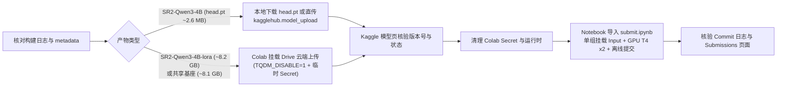

# Agent 上传模型与 Kaggle 提交工作流指南

[文档索引](../README.md) · [Kaggle 提交笔记本说明](kaggle-submission.md) · [Colab 运行说明](colab.md)

本文档总结了从本地或 Google Drive 发布的训练构建（`SR2-Qwen3-4B` 与 `SR2-Qwen3-4B-lora`）向 Kaggle Models 上传版本并完成竞赛提交的标准操作流程。指南面向后续执行自动化发布与提交的 Agent，强调可复现的步骤、环境约束以及实战中验证过的避坑要点。

## 总体流程



---

## 1. 前置核查与鉴权边界

开始上传前，先在本地核对以下两类信息，避免把错误的构建上传到错误的版本号下：

1. **确认构建对应的配置预设**：当 [`scripts/build.py`](../scripts/build.py) 顺序执行多个 YAML 配置时，同一本地/工作区输出路径会被后者覆盖，但 Google Drive 上的 `build-<timestamp>/` 会保留每次运行的完整输出。请核对 [`results/logs/build-*.log`](../results/logs/)，或加载目标 `head.pt` / `adapter.pt` 检查 `metadata` 中的 `created_at`、`pooling`、`head_architecture` 及 `training_config.build_min_lr`，与 [`configs/`](../configs/) 逐一对应。
2. **确认 `KAGGLE_API_TOKEN` 的能力边界**：项目根目录的 `.env` 提供 `KAGGLE_API_TOKEN`。该 Token 可正常用于 `kagglehub.whoami()` 和 `kagglehub.model_upload(...)` 上传模型，但无法直接用于 `kagglesdk` 的内核或提交查询接口（会返回 `401 Unauthorized`）。因此，**模型上传走 `kagglehub`，而 Notebook 导入、Input 挂载与提交触发统一通过 Kaggle 网页端完成**。

---

## 2. 发布模型到 Kaggle Models

Kaggle Models 和 Datasets 的网页上传入口均不支持直接挂载 Google Drive，竞赛评测环境也要求关闭互联网连接（无法在提交运行时临时拉取外部权重）；此外 Kaggle 上引用的公开基座 `Skywork/Skywork-Reward-V2-Qwen3-4B` 并未托管权重文件。基于这些约束，推荐按产物大小分流发布至私人 Kaggle Models（Handle 格式均为 `<owner>/<model-slug>/transformers/default`）：

| 目标模型 Handle | 内容 | 上传策略与频率 |
| :--- | :--- | :--- |
| `dnbide/skywork-reward-v2-qwen3-4b/transformers/default` | 冻结基座快照（约 `8.06 GB`） | 仅上传一次作为共享基础；通过 Colab 上传，且传入 `ignore_patterns=["assets/", ".gitattributes"]` |
| `dnbide/sr2-qwen3-4b/transformers/default` | `SR2_Qwen3_4B/head.pt`（约 `2.63 MB`） | 体积很小，可本地保持 `SR2_Qwen3_4B/head.pt` 目录结构后直接 `kagglehub.model_upload`，也可顺便在 Colab 上传 |
| `dnbide/sr2-qwen3-4b-lora/transformers/default` | `SR2_Qwen3_4B_lora/`（`adapter.pt` + `merged/`，约 `8.19 GB`） | 走 Google Colab 云端上传，避免本地大流量上下行传输 |

### Colab 云端上传标准步骤

如果需要在 Google Colab 中借助已挂载的 Google Drive 上传大体积模型，请遵循以下安全与稳定性规范：

1. **通过 Colab Secrets 传递凭证**：浏览器自动化策略通常会禁止在 `colab.research.google.com` 执行文件选择器上传。可在 Colab 左侧 **Secrets（密钥）** 面板临时新增 `KAGGLE_API_TOKEN` 并开启当前笔记本访问权限；代码中使用完后通过 `finally: os.environ.pop("KAGGLE_API_TOKEN", None)` 清理环境变量。**禁止在单元格输出、日志或回复中打印 Token，也不要把带有临时配置或凭证上下文的 Scratchpad 保存到 Drive。**
2. **导入 `kagglehub` 前关闭进度条**：大文件分片上传时密集刷新的 `tqdm` 进度条极易撑爆 Colab 前端 DOM，导致浏览器脚本响应超时。请务必在首次 `import kagglehub` 前设置 `os.environ["TQDM_DISABLE"] = "1"`。
3. **禁止向同一 Model Slug 并发上传**：向同一个 Handle 调用 `kagglehub.model_upload` 会顺次生成 `V1`、`V2`、`V3`。若两个标签页同时写入同一个 Slug，容易导致版本号与预期反序或在创建版本阶段产生冲突；如需并发，仅限不同 Slug，或将同 Slug 的上传错开并在 `version_notes` 中写清 `<build-timestamp> (<config>.yaml)` 以便事后校验。

Colab 上传代码模板如下：

```python
import os

os.environ["TQDM_DISABLE"] = "1"

from pathlib import Path
from google.colab import userdata
import kagglehub

build_dir = Path(
	"/content/drive/MyDrive/llm-classification-finetuning/models/<build-timestamp>"
)
assert build_dir.is_dir(), f"Missing: {build_dir}"

os.environ["KAGGLE_API_TOKEN"] = userdata.get("KAGGLE_API_TOKEN")
try:
	print("Whoami:", kagglehub.whoami())
	kagglehub.model_upload(
		"dnbide/sr2-qwen3-4b-lora/transformers/default",
		str(build_dir),
		version_notes="<build-timestamp> (<config>.yaml)",
	)
finally:
	os.environ.pop("KAGGLE_API_TOKEN", None)
```

4. **上传后清理与状态确认**：看到上传完成输出后，立即从 Colab **Secrets** 中删除 `KAGGLE_API_TOKEN`，再打开 **管理会话（Manage Sessions）** 终止并删除运行时，关闭 Scratchpad 标签页。随后前往 Kaggle 对应模型页面刷新，确认新版本号已创建、包含全部预期文件且后台扫描处理已完成。

---

## 3. 配置 Kaggle Notebook 并提交竞赛

当前项目沿用已配置好运行环境的竞赛提交 Notebook（[`notebookf38b7506e4`](https://www.kaggle.com/code/dnbide/notebookf38b7506e4)），每提交一次新建一个 Saved Version，避免额外复制分散多个冗余 Notebook。

### 环境与输入核对

1. **更新笔记本代码**：若本地修改了 [`submit.ipynb`](../submit.ipynb)，在编辑器中通过 **File -> Import Notebook** 重新导入，并确保本地改动已运行 `uv run ruff format submit.ipynb`。
2. **锁定运行配置**：每次提交前核查右侧/工具栏 **Settings** 与附加依赖：
   - **Accelerator**：`GPU T4 x2`
   - **Internet**：`Off`（提交代码竞赛必选离线）
   - **Environment**：保持锁定 `Pin to original environment (2026-11-03)`
   - **Dependency 脚本**：保留附加的 `dependencies`（`PM-144562723-...`）
3. **单组挂载待测模型（关键）**：[`submit.ipynb`](../submit.ipynb) 默认的 `MODEL_DIR` 指向 `sr2-qwen3-4b-lora` 的 `V1`。当切换模型类型或指定更高版本（`V2`、`V3`）时，该固定路径可能不存在，代码会自动搜索 `/kaggle/input`，优先匹配 `adapter.pt` + `merged/config.json`，否则匹配 `head.pt` + `BASE_MODEL_DIR`。为防止误加载旧文件或错误版本，**每次提交只应挂载一组待测模型**：
   - 提交 **`SR2-Qwen3-4B-lora`**：仅保留竞赛数据、`dependencies` 与指定版本的 `dnbide/sr2-qwen3-4b-lora`（在 Input 面板显式核对版本号徽章如 `V2`/`V3`），移除任何旧数据集或冻结模型输入。
   - 提交 **`SR2-Qwen3-4B`**：仅保留竞赛数据、`dependencies`、指定版本的 `dnbide/sr2-qwen3-4b` 与 `dnbide/skywork-reward-v2-qwen3-4b`（`V1`），并确认已移除 `dnbide/sr2-qwen3-4b-lora`。

### 触发提交与结果验证

1. 打开 **Submit to competition -> Submit**，为本次保存输入可区分的 **Version Name** 与 **Submission Description**（建议包含模型系列、Kaggle 模型版本、构建时间戳和配置文件名，例如 `SR2-Qwen3-4B_l2` 与 `SR2-Qwen3-4B v2 | build-20261119-053919-408830 (l2.yaml)`），提交后会自动触发 `Save & Run All`。
2. 约 3 至 5 分钟后，在 Notebook 的 **Version History -> Logs** 核验该版本的 3 行公开测试集预运行日志：
   - `Backbone:` 与 `Head checkpoint:` 的挂载路径及版本数字与本次预期一致；
   - `Head: ... trained <UTC timestamp>` 与源构建匹配；
   - 运行健康指标正常：`OOM retries 0`、`failed branches 0`、`Wrote /kaggle/working/submission.csv (3 rows)`、`prior-filled rows: 0`。
3. 前往竞赛 [Submissions 页面](https://www.kaggle.com/competitions/llm-classification-finetuning/submissions) 确认记录处于 `Notebook Running` 或 `Succeeded`（注意竞赛每日提交上限），并在离开编辑器前确认 `Draft Session` 处于关闭状态，避免占用 GPU 额度。
