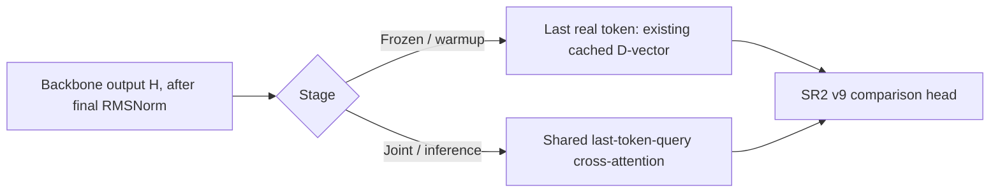

# SR2 LoRA training

[Documentation index](../README.md)

SR2 trains adapters, a shared cross-attention pooler, and a three-class comparison
head over one Skywork reward-trained Qwen3 backbone. Original base parameters remain frozen;
training is non-quantized on one GPU. Each pair is serialized as separate A and B
branches. Warmup pools the last real token; joint training and validation use it
as a query over all real tokens. Both stages train on **original rows
only**; validation makes one head prediction per ID.

```shell
uv run model SR2-Qwen3-4B-lora
uv run model SR2-Qwen3-4B-lora --build --checkpoint-tag experiment
```

SR2 requires the `SR2_Qwen3_4B_lora` model section
and the shared `warmup` section. See [commands](commands.md) for execution modes
and [configuration](configuration.md) for the complete fields and parser defaults.

## SR2 reward-backbone profile

| Profile | Model section | Backbone in shipped presets | Checkpoint / warmup namespace |
| --- | --- | --- | --- |
| SR2 | `SR2_Qwen3_4B_lora` | `Skywork/Skywork-Reward-V2-Qwen3-4B` | `SR2_Qwen3_4B_lora` / `SR2_Qwen3_4B_lora_warmup` |

SR2 loads Skywork's Transformer through `AutoModel`, omitting its scalar reward
head. Its comparison head shares L/M projections across wins and derives the tie
logit from the sum and absolute difference of nonnegative win activations.
The implementation and public Python APIs now live in
`models/SR2_Qwen3_4B_lora/`. Head size, rank, smoothing, rates, and epochs may
differ between presets; read their actual values.

SR2 and the standalone `warmup` command use the same SR2 cache namespace.
The shipped presets select Skywork for both; reuse additionally requires
matching training IDs, labels, and effective model/head settings.

## Last-token query cross-attention pooling

Joint training, joint validation, and production inference insert one shared
`LastTokenQueryCrossAttention` between the backbone and the comparison head.
The input $H\in\mathbb{R}^{B\times L\times D}$ is the complete backbone output
**after** its final RMSNorm; $D$ comes from the backbone configuration (2,560 for
the shipped Skywork model). `last_positions` selects $h_{last}$ and defines the
valid-token mask, including that last real token itself.



Separate affine LayerNorms normalize the query and full sequence in FP32, with
`eps=1e-5`, weights initialized to one, and biases to zero:

$$
Q=\mathrm{LN}_Q(h_{last})W_Q,\qquad
K=\mathrm{LN}_{KV}(H)W_K,\qquad V=\mathrm{LN}_{KV}(H)W_V.
$$

The bias-free projections map $D$ to `cross_attention_dim` (default 256), split
into `cross_attention_heads` heads (default 4, each of width $d_h=64$). Per head:

$$
A=\operatorname{softmax}\left(
\operatorname{mask}\left(QK^\top/\sqrt{d_h},\ j\le last\_position,\ -\infty\right)
\right),\qquad
O=\operatorname{Concat}_{heads}(AV)W_O.
$$

There is no attention dropout and no additional causal mask: the single query
may attend to every real token. $W_O$ is bias-free and maps the concatenated
attention vector back to $D$. The output is
$h_{out}=h_{last}+O\odot m_R$, without a gate or post-residual LayerNorm.
During paired training, one FP32 `[B, D]` residual dropout mask $m_R$, using
`config.dropout` and standard dropout scaling, is shared by A and B. Thus the
pooling operation exchanges A/B outputs under the same mask; the SR2 head also
shares its own win mask. Evaluation disables both masks.

Q/K/V weights use Xavier uniform initialization; $W_O$ starts at zero. For finite
intermediates, the initial pooled values equal the old last-token values. On the
first backward pass, the attention branch's Q/K/V and LayerNorm loss gradients
are zero; $W_O$ can learn immediately and opens the upstream gradient path on
later updates. The pooler adds $4D\,cross\_attention\_dim+4D$ parameters
(2,631,680 with the defaults).

Parameters, gradients, and AdamW moments remain FP32. Projection matmuls and
$AV$ follow `gpu.precision`; probabilities are cast to the value dtype for
$AV$. Both Pre-LNs, the QK matmul (promoted **before** multiplication), scaling,
masking, softmax, and residual fusion run with autocast disabled in FP32.
Joint pooled features stay FP32 through temporary CPU validation storage; the
head retains its existing BF16/FP32 input computation policy.

Frozen SR2 and standalone/inline warmup explicitly bypass this module and retain
their existing `[D]` disk features and head-state cache identities. Joint models
initialize the pooler after the existing head inside an RNG-preserving scope;
pooler construction does not advance head/warmup random state. No full-sequence
features are cached. Pooling selection is explicit and independent of `eval()`
or disabled gradients, so joint validation still uses the trained pooler.

## Swap-equivariant head

For pooled row vectors $A,B$ of width $D$ and classifier width $h$:

$$
\begin{aligned}
P_A &= \operatorname{GELU}(AL-BM+B_1),\\
P_B &= \operatorname{GELU}(BL-AM+B_1),\\
W_A &= P_A\odot m_P,\qquad W_B=P_B\odot m_P,\\
z_A &= W_A R,\qquad z_B=W_B R,\\
C_A &= \max(W_A,0),\qquad C_B=\max(W_B,0),\\
u_{\mathrm{eff}} &= s\operatorname{softplus}(u/s),\qquad s=0.01,\\
t &= 1+\operatorname{softplus}(\mathrm{raw\_t}),\\
z_{\mathrm{tie}} &= b_{\mathrm{tie}}+
\bigl(C_A+C_B-t|C_A-C_B|\bigr)u_{\mathrm{eff}}.
\end{aligned}
$$

Here $L,M\in\mathbb{R}^{D\times h}$ and
$R,u,u_{\mathrm{eff}}\in\mathbb{R}^{h\times 1}$. PyTorch stores the transposed
linear weights; raw parameter `u` has shape `[1, h]`, while `raw_t` and
`tie_bias` are scalars. The effective weights $u_{\mathrm{eff}}$ are positive,
$t>1$, and $b_{\mathrm{tie}}$ (`tie_bias`) is unconstrained.
L/M/R are sampled independently from zero-mean uniform
distributions $U(-\sqrt{3}\sigma,\sqrt{3}\sigma)$ with these standard deviations:

| Matrices | Standard deviation $\sigma$ |
| --- | --- |
| $L,M$ (two `input_projection.weight` blocks) | $1/\sqrt{2D}$ |
| $R$ (`win_readout`) | $0.1/\sqrt{h}$ |

Each bound is computed from the corresponding input width, $D$ or $h$.
$L$ and $M$ produce the win activations reused by the tie branch. The hidden bias
$B_1\in\mathbb{R}^h$ (`win_projection_bias`) is initialized to zero.
For the tie readout, set $\mu=0.2/(3h)$, sample
$U_0\sim U(0.5\mu,1.5\mu)$, then initialize
$u=s\operatorname{invsoftplus}(U_0/s)$ using the stable inverse
$\operatorname{invsoftplus}(x)=x+\log(-\operatorname{expm1}(-x))$.
Thus the initial effective weights reproduce $U_0$.
Initialize `raw_t` to $\operatorname{invsoftplus}(2)$, giving $t=3$, and
`tie_bias` to zero. The head has $2Dh+3h+2$ trainable parameters.
All tie parameters and the win bias use the existing head learning rate and
weight decay.

Win mask multiplication acts elementwise.
Each sample's win branches share the standard dropout mask $m_P$ with
$1/(1-p)$ scaling during training; evaluation disables it.
The tie branch uses these same masked activations, clamps them at zero, and
combines their sum with a learned penalty on their elementwise absolute
difference. It adds no separate projection, GELU, or dropout mask.
Swapping inputs exchanges win logits and preserves the tie logit under the same
masks, because both the clamped sum and absolute difference are symmetric.
For identical inputs, $z_{\mathrm{tie}}=b_{\mathrm{tie}}+2C_Au_{\mathrm{eff}}$.

The implementation batches A/B as `[batch, 2, D]` and stores $L^\top,M^\top$
as contiguous blocks of one bias-free `Linear(D, 2h)`. One call computes both
projections for both inputs; M's branch axis is reversed before subtraction. $B_1$
is added in the projection output dtype. GELU, shared-mask multiplication, and
the R readout operate on both win branches together.

There are three linear calls: the packed L/M projection, the shared win readout,
and the tie readout. The former A-B and L+M tie projection is removed.
All head parameters remain FP32. The win computation follows the existing head
mixed-precision policy and converts its logits to FP32. With autocast disabled,
the tie branch converts masked wins to FP32 before clamping and computes the
sum, absolute difference, effective weights, $t$, and final linear readout in
FP32. Gradients flow through `u`, `raw_t`, `tie_bias`, and the reused wins.
Returned logits remain FP32 in the order A-win, B-win, tie.

Checkpoints save `u`, `raw_t`, and `tie_bias` alongside L/M/R and the win bias.
The architecture marker is
`swap_equivariant_abs_diff_v9`, with embedding combination
`cross_projected_clamped_win_sum_diff`; adapter/pooling/head checkpoint schema is v3,
frozen-head schema is v1, and warmup schema is v5. The marker selects different
warmup cache keys and rejects earlier checkpoints without converting their
weights. Exact parameter-name/shape checks additionally reject earlier layouts,
including v8's `raw_b_tie` and v7's `raw_w_tie`.
Rebuild those checkpoints with the matching configuration; warmup is regenerated.
The initialization policy is versioned separately as
`scaled_uniform_clamped_gelu_tie_v5` in the SR2 warmup identity: L/M/R retain
their scales, $B_1$ starts at zero, and the tie parameters use the initialization
above. The architecture marker isolates old warmup states without a storage
schema change.
See [warmup identity](caching.md#identity) and the
[v8-to-v9 migration](migration.md#current-sr2-v9-head-2026-11-15).
There is no `A/B_swap` setting or orientation averaging for SR2.

## Hardware and input limits

Validation/build uses [`gpu.device`](configuration.md#gpu-configuration). All
branches are right-padded independently without padding masks. Qwen's causal attention
protects real tokens from right padding, and CPU-computed last-real-token
positions select the warmup feature or the joint pooler's query and valid keys.
The backbone still receives no padding mask; the pooler masks padded keys.
KV caching is disabled. Joint training encodes
A then B while retaining both gradient graphs. The head consumes both features,
and one backward pass computes gradients for the head, shared pooler, and adapters.

LoRA **never truncates**. Token preparation validates full canonical branches
before training, and inference checks its inputs before encoding. Empty or
`max_length`-exceeding branches fail with the ID, branch, actual count, and
required minimum limit. Lowering a configured ceiling does not reduce work for
inputs already below it. Shared full-token encodings remain reusable when
limits change, but length checks still run.

For Hub backbones, preparation resolves a fixed revision and uses it for the
tokenizer and weights. Token reuse depends on actual tokenizer content, not
just the model name/revision.

All stages use [SR2 chat-template inputs](data-preparation.md#conversation-serialization)
with no system message. Template output includes its terminal newline and is
encoded without additional special tokens. Full-data builds validate complete
input lengths before loading backbone weights. Plain-text checkpoints require
rebuilding.

| Precision | Backbone / pooled CPU features | Trainable state and head computation |
| --- | --- | --- |
| `bf16` | BF16 backbone residuals/checkpoint inputs and frozen/warmup features; FP32 joint pooled features | FP32 parameters, gradients, and AdamW moments; BF16 pooler projections and head computation; FP32 pooling normalization/scores/residuals and logits |
| `fp16` | FP16 backbone compute; FP32 pooled features | FP32 trainable state and head with gradient scaling; FP16 pooler projections, FP32 normalization/scores/residuals |
| `fp32` | FP32 | FP32 pooler, head, and trainable state |

BF16 support is checked on each selected GPU. BF16 LoRA models disable PEFT's
input dtype upcasting once after adapter initialization, fixing the policy for
the model instance across encoding and checkpoint recomputation without repeated
model traversal. Adapter parameters remain FP32. Other precisions and standalone
warmup retain their existing input dtype behavior. RMSNorm retains FP32 variance
calculation.
Absolute values, Softplus transforms, and final logit arithmetic remain FP32 in every mode.

With `sdpa`, LoRA permits Flash, memory-efficient, and cuDNN backends and disables
math fallback during warmup, joint training, validation, and
backbone checkpoint recomputation. The single-query pooler computes explicit
linear-size scores separately from these backbone SDPA restrictions.
Unsupported fused backbone inputs fail explicitly. Scoped flags
are restored on exit; explicit `eager` attention is available. Training/validation
keep their native GQA policy.

## Measured input lengths

The 2026-10-27 SR2 rebuild uses `sr2-qwen3-chat-template-v1` and the official
Skywork tokenizer at revision `fd958fef475f323f4e6b195930e3dd918485c668`, encoded
with `add_special_tokens=False` and no truncation. These values cover both A/B
branches of all original training rows, before augmentation:

| Statistic | SR2 rebuild value |
| --- | ---: |
| Original IDs | 57,477 |
| Median branch | 297 tokens |
| 99th percentile | 2,231.94 tokens |
| Longest branch | 13,866 tokens |
| Canonical A+B token total | 44,873,727 |

The longest branch is A for ID `2995198009`. All current presets set both warmup
and SR2 `max_length` to 13,866. New training inputs must still pass the normal
length checks. The matching saved split and its fingerprint are documented under
[data preparation](data-preparation.md#saved-sr2-split-2026-10-27).

### Historical plain-text inputs

These are **historical measurements**, not a guarantee for the current saved
split. A 2026-10-20 snapshot used
`aligned-prompt-newline-response-v1`, the Qwen3-4B tokenizer at revision
`1cfa9a7208912126459214e8b04321603b3df60c`, default special tokens, and no truncation.

| Statistic | Historical value |
| --- | ---: |
| Original IDs | 57,477 |
| Median branch | 283 tokens |
| 99th percentile | 2,193 tokens |
| Longest branch | 13,514 tokens |
| Canonical A+B token total | 43,035,297 |

The longest branch was A for ID `2995198009`; B had 4,225 tokens. The snapshot's
Parquet SHA-256 was
`0db037aac8f94bf68d3f6e02b2bf4214e6bf4817ed01d4c475af5c2f41fab4ff`, which differs
from the checked-in manifest. Its int32 token payload was about 164 MiB before
offsets/metadata. Current training inputs are checked independently.

## Optimization and head warmup

| Stage | Trainable work | Validation / persistence |
| --- | --- | --- |
| Head warmup, cache miss | Load cached frozen features and extract missing branches with adapter forwards disabled; train only the head with epoch-based exponential decay from `warmup.learning_rate` to `warmup.build_min_lr` across `warmup.build_epochs`, keeping the rate fixed within each epoch | Evaluate the full training set and, for holdout runs, validation after each epoch using shared features; save completed head/optimizer/RNG state |
| Head warmup, complete cache hit | Restore compatible head and training state | Inline LoRA skips all warmup work; standalone warmup loads cached features, extracts missing branches, and recomputes both losses without training |
| Head warmup, lower-epoch cache hit (fixed rate only) | Load/extract frozen features, reconstruct shuffle state, and restore compatible head/optimizer/RNG state; train only remaining epochs | Evaluate after each remaining epoch and save a separate target-epoch cache, preserving the source |
| Joint training | Clear AdamW moments and step counters once at entry, then train adapters and the main head group at the cosine-decayed base `learning_rate`, with separate scaled rates for `raw_t` and cross-attention | Fresh backbone and cross-attention extraction, then head validation after each joint epoch |
| Full-data build | Same training stages on all original IDs from both partitions | No validation; save adapters/pooling/head after the final epoch |

The shared warmup section supplies build epochs, head batch size, initial and
minimum learning rates, the `raw_t` learning-rate multiplier, extraction budget,
and smoothing.
Inline warmup's remaining model/head settings come from the selected LoRA section.
`warmup.build_epochs: 0` skips warmup extraction
and cache I/O. See [standalone versus inline settings](configuration.md#standalone-warmup).
Exponential decay reuses only an exact target-epoch cache. Fixed-rate warmup
(`warmup.build_min_lr` equal to `warmup.learning_rate`) can also continue from the largest compatible lower
epoch; all other cache identity fields must match.

Every path into joint training clears the optimizer state before its first update,
including fresh warmup, complete cache hits, and partial-cache continuation.
The trained head weights, optimizer parameter groups, GradScaler, and RNG state
are preserved at this transition. Subsequent joint epochs retain their accumulated
AdamW state. Warmup caches still save optimizer state for warmup continuation.

Adapter-free warmup features are persisted by branch token content and reused
across standalone/inline runs and head configurations. Only missing unique
branches are extracted. The current CPU tensor is shared by the shuffled
training loader and fixed-order train/validation inference loaders; its views
are released before joint training. See [warmup features](caching.md#warmup-features)
for compatibility and refresh rules. For a 57,477-ID, 2,560-dimensional backbone,
both branches' raw feature tensor is about
0.55 GiB in BF16 or 1.10 GiB in FP32, excluding loader batches and metadata.

Both stages normalize loss by the actual rows in each optimizer update, then
clip gradients and apply optimizer/scaler handling once per update. A short
final group merges into the previous full group; a smaller-than-one-group epoch
still updates once. For example, 27 warmup rows with batch size 8 use forward
batches of 8, 8, 8, and 3, but update groups of 8, 8, and 11 rows.

| Stage | Target rows per update | Updates per nonempty epoch |
| --- | --- | --- |
| Warmup | `warmup.training_batch_size` | `max(1, rows // warmup.training_batch_size)` |
| Joint | `G = training_batch_size * gradient_accumulation_steps` | `max(1, rows // G)` |

`gradient_accumulation_steps` applies only to joint training. Both stages use
configured label smoothing for training and unsmoothed validation loss.
Warmup `train_loss` is recomputed over the complete training set after all
optimizer updates in each epoch, with the epoch's final weights, dropout disabled,
and warmup label smoothing. It sums losses across all rows and divides by the
actual row count, including a short final inference batch. Joint `train_loss`
remains the row-weighted average observed during optimization.
There is no early-stopping checkpoint selection: holdout publication uses the
final epoch. Reused warmup contributes no old losses, timings, or executed epochs;
joint epoch numbers retain their configured warmup offset.

`LoRATrainingHistory.executed_warmup_epochs` and `executed_joint_epochs` count
only epochs executed by the current call, including zero warmup epochs for
an exact hit or disabled warmup. Full-data builds expose both counters through
`ModelBuildResult` and the CLI summary; `ModelBuildResult.epochs` remains their
sum. Its optional stage counters default to `None` for other callers.

For warmup identity and restoration details, see [warmup caches](caching.md#lora-head-warmup).

### Learning-rate decay

Frozen SR2 builds and standalone/inline warmup use exponential decay
once per epoch. LoRA joint training uses an independent cosine curve once per
planned optimizer update. Each stage keeps `raw_t` in a separate AdamW
parameter group, while all other classifier parameters remain in the main head
group with their existing weight decay.

| Stage | Base head rate | `raw_t` multiplier |
| --- | --- | --- |
| Frozen SR2 validation/build | Frozen section's plateau/exponential rate | `SR2_Qwen3_4B.t_lr_multiplier` |
| Standalone/inline warmup | Warmup section's exponential rate | `warmup.t_lr_multiplier` |
| LoRA joint training | LoRA section's cosine rate, shared with adapters | `SR2_Qwen3_4B_lora.t_lr_multiplier` |

At every epoch or update, `raw_t_lr = base_head_lr * t_lr_multiplier`. Each
multiplier defaults independently to `1.0` and must be finite and either `0` or
at least `1`. A zero multiplier keeps `raw_t` at zero learning rate throughout
that stage. The schedules derive group rates from the current base rate and
explicit multipliers, including at a cosine endpoint of zero.

Joint cross-attention uses two additional AdamW groups at
`base_head_lr * cross_attention_lr_multiplier` (default multiplier `10.0`).
Q/K/V/O weights use the LoRA section's `weight_decay`; both LayerNorms have zero
weight decay. The existing group-multiplier mechanism preserves these rates
when entering joint training and throughout its delay and cosine decay,
including the same `min_lr_ratio` endpoint. Warmup bypasses the pooler and never
creates its gradients or optimizer moments. Its groups are added only when
entering joint training. The first joint epoch clears all
optimizer moments once, preserving weights and the independent `raw_t` rate.

For head training, let `N = build_epochs`, `L = learning_rate`, and
`M = build_min_lr` in either the frozen SR2 or warmup section. For `N > 1`:

```text
epoch_multiplier = (M / L) ** (1 / (N - 1))
decay_rate = (ln(L) - ln(M)) / (N - 1)
lr = L * exp(-decay_rate * epoch_index)
```

The epoch index spans `0` through `N - 1`. The scheduler explicitly sets the first
rate to `L` and the final rate to `M`. Each epoch keeps that rate throughout,
including FP16-skipped updates. A single epoch uses `L`; `M = L` keeps every epoch
fixed. For example, `L = 0.001`, `M = 0.0002`, and `N = 4` yield approximately
`0.001`, `0.000584804`, `0.000341995`, and `0.0002`.

`build_min_lr` defaults to the corresponding initial head rate divided by five
and must be finite and in `(0, L]`. Frozen SR2 builds map `build_epochs`,
`training_batch_size`, `learning_rate`, and `build_min_lr` to the shared internal
`warmup_build_epochs`, `warmup_training_batch_size`, `warmup_learning_rate`, and
`warmup_build_min_lr` settings. Standalone and inline warmup share the same
mapping. Configurations, snapshots, checkpoint training metadata, and decaying
cache identities store the minimum rate; only the scheduler derives its
coefficient. `warmup.build_epochs: 0` skips the stage without creating a scheduler.

Frozen SR2 validation uses ReduceLROnPlateau on the full unsmoothed validation
loss after each epoch, with `factor: 0.95` and initial `patience: 2` as defaults
and fixed `threshold=0` and `min_lr=0`, retaining the default `eps=1e-8`.
Reductions apply to the following epoch. A proposed main head rate reduction
of at most `eps` is ignored for all groups. Each accepted reduction computes
the main head rate and then scales `raw_t` from it, preserving the configured
multiplier.
Whenever `early_stopping` consecutive epochs fail to strictly lower the overall
best validation loss, `patience` decrements by `1` in place and the
early-stopping counter resets while `patience > 0` (preserving model, optimizer,
current rate, and all other scheduler state); training stops after a full
`early_stopping` window at `patience = 0`. Strictly lower losses reset the
early-stopping counter without restoring `patience`, and rate reductions alone
do not reset early stopping. It ignores the build schedule
and uses no head-state cache; see
[frozen SR2 validation](models.md#frozen-skywork-reward-backbone).

Decaying builds/warmup reuse only exact target-epoch caches. Changing the minimum
rate or target epoch count changes the full curve and trains from epoch index
`0` on a cache miss. Lower-epoch continuation remains supported only when
`build_min_lr = learning_rate`. A non-default warmup `t_lr_multiplier`, including
zero, participates in cache identity; `1.0` adds no metadata key and retains
existing cache compatibility. Changing only the joint multiplier preserves
warmup cache reuse.

Joint training uses `U = max(1, rows // G)` updates per epoch and `N = epochs * U`
total updates, using the joint optimizer-group size `G` above.
`lr_decay_delay_epochs` defaults to `0` and counts joint epochs independently of
head warmup. The first `H = min(lr_decay_delay_epochs, epochs) * U` updates keep
the initial `learning_rate`. The total epoch count stays unchanged. For planned
update index `i` from `H` through `N - 1`, when `N - H > 1`, the remaining curve is:

```text
p = (i - H) / (N - H - 1)
lr = learning_rate * (min_lr_ratio + (1 - min_lr_ratio) * (1 + cos(pi * p)) / 2)
```

The first update after the delay uses the initial rate and the last uses
the minimum when at least two updates remain. If only one update remains, it
uses the initial rate. A delay at least as large as `epochs` keeps the rate fixed
throughout joint training. With a delay of `0`, the original curve is preserved.
Its `min_lr_ratio` defaults to `0.125`; `0` reaches zero and `1` keeps the rate fixed.
The schedule applies immediately before each complete optimizer group's update attempt and
advances once for that consumed group, including when FP16 gradient scaling
skips the parameter update. Micro-batches and evaluation do not advance a
schedule; warmup does not advance the joint schedule. Packing and short-tail
merging retain the update counts above; epochs do not restart decay.

At the start of joint training, adapters and the main head group switch to
`SR2_Qwen3_4B_lora.learning_rate`; the `raw_t` group switches to that rate times
`SR2_Qwen3_4B_lora.t_lr_multiplier`, and the two cross-attention groups enter at
the base rate times `cross_attention_lr_multiplier`. They begin a fresh cosine
curve whether
warmup was executed, restored from cache, or disabled. This transition clears
AdamW moments and step counters once while preserving the trained weights,
parameter groups, GradScaler, and RNG state. Subsequent joint epochs retain
their accumulated optimizer state. These joint-only settings do not change
warmup cache identity or production checkpoint compatibility.

## Two-stage validation

Each joint-validation call extracts canonical A/B features using the current
adapters and shared cross-attention pooler, then runs the head over original IDs.
Backbone extraction uses the
selected LoRA section's `extraction_budget`; head inference uses `head_inference_batch_size`.

Extraction completes before head inference, stores temporary CPU features, and
releases them on return. Features are never reused across joint epochs/runs.
Warmup train and validation inference instead reuse that stage's frozen features.
Inline warmup uses `head_inference_batch_size` for both evaluations; standalone
warmup uses `warmup.training_batch_size`. Logs distinguish warmup training
evaluation, warmup validation, and joint validation; joint-validation timing
includes both extraction and head inference. Validation still works when warmup is
disabled. See [extraction packing](configuration.md#extraction-token-budgets).

## Optional token-budget training batches

Two passes control joint micro-batches, independently of extraction budgets.
For `n` rows with independently padded branch lengths `L_A` and `L_B`, both use
the total padded A/B token cost `P = n * (L_A + L_B)`.
Planning, cached-plan validation, and runtime checkpointing share this cost.
Runtime adds the two branches' actual padded tensor sizes.

### Initial plan and checkpointing threshold

With `gradient_checkpointing_threshold: 0`, initial batches use
`training_batch_size` and all joint batches use non-reentrant gradient
checkpointing. A positive threshold enables a reusable global plan:

1. Select original training IDs, or all original IDs for a build.
2. Compare three stable ascending sorts by `(A_length, B_length)`,
   `(B_length, A_length)`, and `(A_length + B_length, A_length, B_length)`,
   breaking ties by sample ID and then orientation.
3. Divide each candidate into groups of `G` rows and a possible short tail.
4. Within each group, pack under `P <= threshold` using the shared packing rule
   below. Choose the candidate with the fewest micro-batches, then the lowest
   total `P`. Exact ties retain the first candidate in the order above.

Both passes compare two candidates within each group, choosing the fewest
micro-batches, then the lowest total `P`:

- A suffix dynamic program finds the optimal contiguous partition of rows that
  individually fit the applicable limit. The initial pass preserves the current
  global sort's order within each group; the second pass uses descending
  `A_length + B_length`, then ascending sample identity. Rows individually above
  the limit stay alone and do not interrupt the eligible sequence. Interval
  maxima are updated incrementally; extension stops as soon as `P` exceeds the
  limit. Equal DP scores retain the first enumerated cut, shortest prefix first.
- The retained best-fit candidate processes rows by descending
  `A_length + B_length`, then ascending sample identity. Each row joins the
  feasible micro-batch with the smallest remaining budget, breaking ties by
  creation order; if none fits, it starts a new micro-batch. Exact ties between
  the two candidates retain best-fit.

DP is optimal for contiguous cuts in the specified order; the overall packing
remains a heuristic for unrestricted assignments. Both candidates use the same
`P`, with extra DP space linear in group size. The DP and best-fit each take
quadratic time in the worst case; over-limit intervals and permanently closed
best-fit batches are skipped. When all eligible rows fit in one micro-batch,
the packer returns that result directly in best-fit order.

A single pair above the threshold remains alone. When `P` is at or below a
positive threshold, checkpointing is disabled; above it, checkpointing is enabled
for **both branches through backward**.
Both branch graphs remain live until the single backward pass. Setting the
threshold too high can exceed GPU memory because non-checkpointed batches keep
both branches' full activations. Lower the positive threshold, or set it to `0`
to force gradient checkpointing on all joint batches.
Warmup and inference disable checkpointing.

The same per-pair decision also checkpoints each branch's cross-attention
forward, with its already drawn shared residual mask supplied as an input.
Recomputation does not draw a new residual mask.

### Epoch groups and the second packing pass

For positive thresholds, base group membership is cached. Each zero-based joint
epoch shuffles full groups with `random_state + joint_epoch`, then merges any
short tail into the last shuffled full group. That merged update stays last;
a lone short group runs alone.

A positive `gradient_checkpointing_budget` then combines only checkpointed
**singleton** micro-batches inside each finalized update, using the shared
packing rule with `P <= budget`. For positive thresholds, eligible singletons
have `A_length + B_length > threshold`; combining them keeps checkpointing
enabled. Existing multi-row batches and non-checkpointed singletons remain
intact. Neither pass crosses a finalized update boundary. Combined `P` may equal
the budget; an oversized pair still runs alone without truncation. For positive
thresholds, the budget must exceed `2 * threshold` to combine any two singletons;
a smaller budget leaves all eligible singletons running alone.

The second pass also works with threshold `0`: all micro-batches run with
checkpointing enabled. In this mode, initial micro-batches of size 1 (e.g. from
`training_batch_size: 1`) are treated as singletons and repacked in memory under
`P <= budget`; existing multi-row initial batches (`training_batch_size > 1`)
remain intact. A zero budget disables only this repacking pass. Positive-threshold
plans still shuffle micro-batches inside each update after repacking. The merged
update remains last. Epoch batches are memoized so length queries match iteration
without consuming extra shuffle state.

Dynamic micro-batches can exceed `training_batch_size`. Update counts and loss
normalization use finalized row groups, not micro-batch counts. Only initial
plans are persisted; second-pass packing is not part of the plan key. See
[plan compatibility](caching.md#lora-batch-plans).

Packing can change accumulation order, dropout draws, and attention kernels.
Throughput and peak-memory improvements depend on the workload and GPU; preset
budgets are not benchmark guarantees.

## Training progress

Progress has three independent stages. Each starts its own timer and work counter,
accumulates across all of its epochs, and finishes with one 100% log after its
work and result checks succeed. Failures do not force completion.

| Stage | Included work | Logging interval |
| --- | --- | --- |
| **Warmup feature extraction** | All branch batches for the deduplicated train/validation IDs, extracted once before head training | Approximately 20% |
| **Head warmup** | All warmup epochs, including optimizer groups, full-training-set evaluation, and validation | Approximately 20% |
| **Joint training** | All joint epochs, including optimizer groups, validation feature extraction, and validation head inference | Approximately 10% |

Each completed optimizer group, extraction branch batch, or head inference batch
counts as **1** work unit. There are no warmup/joint weighting factors.
Dynamic training micro-batches do not change update-group work counts;
FP16-skipped updates still advance progress. Extraction milestones use the actual
loader length: 46 branch batches log at batches 10, 19, 28, 37, and 46, including
the final 100% log.

For an inline holdout run, let `W` and `J` be the warmup/joint update counts above,
`T = ceil(training_rows / head_inference_batch_size)`, and
`V = ceil(original_validation_rows / head_inference_batch_size)`, and `E` be the
number of branch batches in each joint-validation extraction loader. Warmup
extraction counts its own loader's batches; Head warmup totals
`remaining_warmup_epochs * (W + T + V)`, where remaining epochs exclude those
restored from cache; Joint training totals `epochs * (J + E + V)`.
Full-data model builds use all training IDs and `E = V = 0`.

Standalone warmup uses `warmup.training_batch_size` for the denominators of
both `T` and `V`. A head miss runs Head warmup, without Joint training. Warmup
feature extraction precedes it only when unique branches are missing. A complete
head hit logs cache reuse and runs a separate **Cached head evaluation** stage with
`T + V` work and approximately 20% milestones. It executes zero training epochs.
Complete inline cache hits log reuse without creating progress records for either
skipped warmup stage. Partial head hits in either mode run Head warmup for only
the remaining epochs, with epoch numbers continuing from the source; extraction
counts only missing branches. Complete feature hits have no extraction stage.
Disabled warmup also enters Joint training directly.

Logs retain `time: HH:MM:SS/HH:MM:SS`, meaning **elapsed/estimated_total**. The
right-hand duration is the current stage's estimated total, calculated as
`stage_elapsed * stage_total_work / stage_completed_work`, rather than time
remaining. At 100%, both durations equal that stage's actual elapsed time. Stage
transitions reset all work and timing; neither earlier stages nor cache reuse
contribute to the estimate. CPU preparation, cache I/O, saving, and publication
are outside the stage boundaries. Warmup extraction starts after its loader is
prepared; Head warmup starts after its feature views and loaders are ready and
ends before saving the warmup cache; Joint training starts after transition setup.

See [shared progress behavior](models.md#training-progress) and
[timing metrics](reports.md#timing-metrics). Python callers may still pass a
`TrainingProgress` to `LoRATrainer.fit()`; it is reset at each stage boundary.
Otherwise an initially inactive counter is created for that call. The shared
counter supports `start_stage(stage=..., total_steps=..., milestone_percent=...)`
and `finish_stage(description)`. The optional `update_interval_seconds` argument
on `start_stage` selects time-based updates with millisecond precision instead of
percentage milestones. `finish_stage(description, emit=False)` verifies all work
completed without printing. Frozen SR2 validation uses silent per-epoch counters
and emits summaries every `early_stopping` epochs, plus the stopping epoch.
Existing construction with `total_steps` retains
the legacy 5% logging interval and automatic completion.

## Memory tuning

Adjust the setting for the stage that actually failed:

| Stage | Main controls |
| --- | --- |
| Warmup backbone extraction | Lower `warmup.extraction_budget` |
| Warmup head training | Lower `warmup.training_batch_size` |
| Joint backbone training | Lower a positive checkpointing threshold; lower the second-pass budget or set it to `0` |
| Fixed initial joint batches, threshold `0` | Lower `training_batch_size`; adjust accumulation if retaining effective batch size |
| Joint-validation extraction | Lower the selected LoRA section's `extraction_budget` |
| Head validation | Lower `head_inference_batch_size` |

With a positive threshold, keeping `training_batch_size * gradient_accumulation_steps`
fixed does not lower packing limits; change the token controls instead. A budget
is not an input cap: oversized single samples still run alone. Keep `max_length`
large enough for required inputs. FP16/BF16 can reduce memory where supported;
checkpointing affects joint training only. The implementation reports OOM
rather than silently changing precision or shortening inputs.

Cross-attention retains full-sequence information and adds FP32 Pre-LN buffers,
so training and joint-validation peaks exceed those of last-token slicing.
One FP32 `[tokens, D]` buffer costs `4 * tokens * D` bytes. Checkpointing also
covers the pooler on checkpointed joint batches, but cannot remove its temporary
forward buffers. Reassess token budgets for the available GPU; the shipped
budgets have not been benchmarked for this pooling architecture.

## Checkpoints

`--build` atomically writes `models/SECTION/adapter.pt`, or `adapter_TAG.pt` for
a checkpoint tag. Schema v3 contains `adapter_state_dict`, FP32
`pooling_state_dict`, FP32 `head_state_dict`, and compatibility metadata;
base weights are exported separately as described below. Optimizer state is
not stored. These are inference artifacts, not checkpoints for resuming
interrupted joint training.

Before initializing CUDA, full-data builds prepare their data/tokens/batch plan
and probe both the adapter/head and merged-backbone destinations for writability.
Saving reloads the staged file on CPU to validate its metadata and tensors,
then atomically replaces the destination. Failed writes or staged
validation preserve the previous checkpoint and clean up the temporary file.
The CPU snapshot used for serialization is released before readback; neither
the probe nor readback loads base weights or runs inference.

CPU readback checks model name, serializer, classifier width/dropout, head
architecture, LoRA rank/alpha/dropout/targets, schema/classes, pooling/truncation
policy, bias, and `training_quantization: none`. Pooling identity is
`last_token_query_cross_attention_v1`; attention dimension and head count must
match independently, even when tensor shapes alone would allow another head
count. Readback checks head names/shapes and all pooler tensor names, shapes,
FP32 dtypes, and finite values, and records the saved Hub base revision. Local base weights are
neither embedded nor content-fingerprinted by the production checkpoint.

`max_length` and internal `ab_swap` are recorded but excluded from readback
compatibility comparisons. Device, precision, attention, TF32, batches, and
accumulation are also outside these comparisons. Historical quantized or
retired-head checkpoints are incompatible. Old last-token production checkpoints
also require rebuilding; missing pooling weights are never silently initialized.
Current v9 warmup features and head states remain compatible with this pooling
upgrade. See [migration](migration.md) for older head formats.

### Merged backbone export

Every SR2 `--build` also writes `models/SECTION/merged/`, or `merged_TAG/` with
the same checkpoint tag. The adapter/head checkpoint is saved and validated
first, before the PEFT model is consumed by export. Build switches the model to
evaluation mode, moves the existing backbone to CPU, and calls
`merge_and_unload(safe_merge=True)`. The returned plain `AutoModel` is saved in
Safetensors format with `max_shard_size="5GB"`, preserving the backbone's build
precision and using its own parameter names rather than the source reward
model's prefixes. The training tokenizer is saved alongside the model config.
The classification head and cross-attention pooler remain in `adapter[_TAG].pt`;
neither is merged into the backbone.

`export_metadata.json` records `model_name`, `base_revision`,
`training_source_sha256`, the corresponding `checkpoint_file` and its
`checkpoint_sha256`, `dtype`, and a UTC `created_at` timestamp. The checkpoint
digest identifies the exact adapter/head artifact paired with the export.

All files are written in a sibling staging directory. Validation reloads the
configuration and tokenizer using local files only, checks the tokenizer
vocabulary/special tokens/chat template, and opens each Safetensors file to
check its structure and tensor names, shapes, and dtypes against the merged
backbone. Shard-index coverage must be complete, and adapter layers/tensor names
must be absent. Validation does not load another copy of the backbone.

Replacement moves the previous export to `.merged-backup` (or
`.merged_TAG-backup`), promotes the staged directory, and removes the backup
after success. A failed promotion restores the previous directory when possible;
an unsuccessful restore reports the backup location. An interrupted promotion
that left only a backup is recovered during the next write preflight. When both
the destination and a leftover backup exist, preflight reports both paths for
review instead of discarding either. Temporary files are cleaned up after
failure, and cleanup errors do not replace the export error.

An export failure returns a command failure while retaining the already saved
adapter/head checkpoint. Both outputs must be saved before build reports success.
