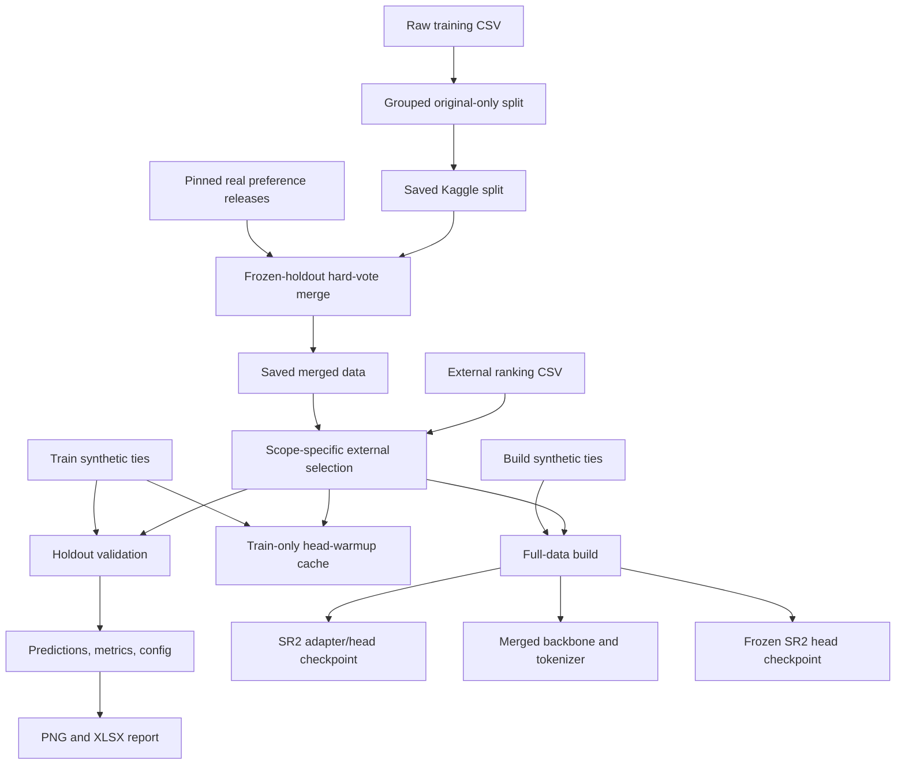

# Codebase reference

Use this map to find ownership before changing implementation. Keep user
interaction in CLI modules, orchestration in pipelines, and domain behavior in
focused classes. Prefer package public exports to private cross-package helpers.

## Documentation boundaries

| Document | Owns |
| --- | --- |
| [README.md](README.md) | Overview, active profiles, and navigation |
| [docs/getting-started.md](docs/getting-started.md), [docs/colab.md](docs/colab.md), [docs/kaggle-submission.md](docs/kaggle-submission.md), [docs/kaggle-agent-workflow.md](docs/kaggle-agent-workflow.md) | Local/remote setup, operational workflows, agent publish/submit guide, and the Kaggle submission notebook |
| [docs/commands.md](docs/commands.md), [docs/configuration.md](docs/configuration.md) | CLI behavior, field definitions, defaults, path rules, and batch experiments |
| [docs/data-preparation.md](docs/data-preparation.md), [docs/external-training-data.md](docs/external-training-data.md), [docs/recommended-external-data.md](docs/recommended-external-data.md), [docs/models.md](docs/models.md), [docs/lora.md](docs/lora.md) | Data/model behavior, candidate external datasets, and training algorithms |
| [docs/caching.md](docs/caching.md), [docs/reports.md](docs/reports.md) | Cache identities/APIs, artifacts, reporting, and measurements |
| [docs/troubleshooting.md](docs/troubleshooting.md), [docs/migration.md](docs/migration.md) | Failure diagnosis and historical formats |
| This file | Runtime flow, module responsibilities, artifact map, and implementation invariants |

Keep detailed behavior in its owning guide and link to it here. Preset parameter
values belong in YAML; parser defaults belong in the configuration reference.
Update this map when ownership or runtime flow changes. Preserve historical run
snapshots when updating current documentation or presets.

## Runtime flow

The saved split included in Git can enter this flow without downloading raw data.
Standalone warmup is optional; inline LoRA runs create/reuse their compatible
warmup state. Validation does not save production checkpoints. Builds use Kaggle
IDs from both partitions. Current presets select external rows from the saved
merge to match the active Kaggle token volume and tie share by row count. See
[ranked external selection](docs/data-preparation.md#ranked-external-training-selection).
The presets set both `data.train_supplement_path` and
`data.build_supplement_path` to `null` (both `tie_duplicate` and `synthetic_tie`
supplements are temporarily disabled); when enabled, validation and standalone
warmup use the train supplement while builds use only the build supplement. The
frozen validation rows remain real-only.
Frozen SR2 saves only its independent head; LoRA builds
also export the merged backbone with its tokenizer.

Paths and `.env` resolve from the process working directory. The batch scripts
instead derive the project root from their own files and launch children there.
See [path resolution](docs/configuration.md#configuration-files-and-paths).

## Entry points

Console scripts are declared in [pyproject.toml](pyproject.toml).

| Command | Module under `src/llm_classification_finetuning/` | Responsibility |
| --- | --- | --- |
| `init` | `cli.py` | Download missing `train.csv`, then preprocess |
| `data` | `data/cli.py` | Download missing `train.csv` only |
| `preprocess` | `preprocess/cli.py` | Rebuild the processed holdout |
| `model` | `models/cli.py` | Parse selection/mode, run profiles, report independent training/validation and global GPU peaks for validation/build/warmup, and print summaries |
| `result` | `result/cli.py` | Select a validation run and synthesize reports |

CLI modules translate expected `DataPreparationError` subclasses to exit status
`1`; parser errors retain argparse behavior. `models/cli.py` owns `ALL` iteration
and the build-only `warmup` selector outside the registry. Unsupported warmup
flags are rejected before data/GPU setup. Checkpoint tags require `--build`.
Business logic stays below this layer.

[scripts/validate.py](scripts/validate.py) runs batch holdout validation;
[scripts/build.py](scripts/build.py) runs full-data builds and standalone warmup.
Both own independent explicit model/config selection, sequential subprocesses,
terminal/log streaming, and failure summaries. Usage belongs in
[batch validation](docs/commands.md#batch-validation) and
[batch builds](docs/commands.md#batch-builds).

[data/merge_external_data.py](data/merge_external_data.py) invokes the
dedicated real-data merger without rebuilding the Kaggle holdout. It accepts
`--config`, `--baseline-path`, and `--output-dir`; defaults and artifact meanings
belong in [data preparation](docs/data-preparation.md#merged-external-preferences).
Both batch scripts load each selected config from the project-root cwd and ensure
its saved data, any ranking CSV, and its scope-specific supplement before
launching the model child. `--data-source-root` can fill missing files from a
project mirror, including optional merge token statistics when restoring ranked
training data.
Successful data preparations are shared by resolved path within the batch;
preparation failures use the existing task log and failure summary.

The ignored local `!validate.ipynb` and `!build.ipynb` provide Colab setup and
their corresponding batch workflows. The build notebook additionally copies
current SR2 outputs to timestamped Drive backups before runtime release,
retaining the runtime if copying fails. Their behavior belongs in
[Colab](docs/colab.md#local-notebook-behavior).
Both notebooks pass their configurable `DRIVE_DATA_ROOT` project mirror
to the batch script; complete local processed data bypasses that source.

[submit.ipynb](submit.ipynb) is the tracked, self-contained Kaggle inference notebook (GPU
T4 x2, Python 3.13+, offline inference after upload-time dependency setup). It sits
outside the package and the `model` CLI: it reads either a merged LoRA build's
`adapter.pt` head and `merged/` backbone or a frozen SR2 `head.pt` checkpoint paired
with the base `Skywork/Skywork-Reward-V2-Qwen3-4B` backbone directory (`BASE_MODEL_DIR`)
and writes `submission.csv`. It duplicates the SR2 head and the conversation serializer.
Mirror changes to the head or the conversation serialization format there.
Behavior belongs in [Kaggle submission](docs/kaggle-submission.md).

## Package map

Paths below are relative to `src/llm_classification_finetuning/`.
Package `__init__.py` files expose intended public interfaces unless noted.

### Application and data preparation

| Module | Owns |
| --- | --- |
| `__init__.py` | Working-directory `.env` loading before library imports; PyTorch allocator and HF endpoint/Xet defaults without overriding explicit environment settings |
| `config.py` | Immutable config objects, strict YAML validation, data/cache/result path resolution (including shared `resolve_result_dir`), and effective shared warmup settings |
| `model_storage.py` | Native Hub cache routing through `load_pretrained`, offline local-only loading and actionable missing-file errors; timed backbone loading with scoped load-report suppression and restoration of progress-bar settings |
| `cli_config.py` | Shared `--config` argument |
| `cli_output.py` | Shared download/split summaries |
| `errors.py` | Expected domain-error hierarchy |
| `timing.py` | Unbounded `HH:MM:SS` duration formatting with optional millisecond precision for fast validation logs |
| `pipeline.py` | `PrepareDataPipeline`: download/preprocessing orchestration and optional download-progress callback; `EnsureProcessedDataPipeline`: local processed-data checks and optional project-mirror restoration without preprocessing |
| `data/downloader.py` | Missing Kaggle training CSV download and single-file ZIP normalization |
| `data/external.py` | Pinned official dataset identities, download/reuse and LFS checksum verification, raw source lock manifest |
| `external_pipeline.py` | `MergeExternalDataPipeline`: frozen Kaggle baseline, conversion/voting orchestration, complete branch length statistics, whole-battle model-context exclusion without truncation, staged audits, publication and readback checks |
| `preprocess/external.py` | Strict text-only source adapters, restricted NumPy container-representation decoder, Arena history alignment, hard-label conversion, and source vote identities |
| `preprocess/deduplication.py` | `ExternalBattleDeduplicator`: complete-prompt/unordered-pair identities, validation exclusion, optional independent hard-vote merging, conflicting-vote diagnostics and representative/status/count audits |
| `preprocess/splits.py` | Exact-response tie correction before labels/prompt hashes, grouped class quotas, balance orchestration, original-only integrity summaries, and processed publication |
| `preprocess/synthetic_tie.py` | Deterministic train/build self-response tie generation with dynamic counts, exact rational win-rate adjustment, full source/selection/replacement audits with bounded-volume streaming, and staged publication; invoked by `data/generate_synthetic_tie.py` |
| `preprocess/tie_duplicate.py` | Deterministic train/build distinct-response real tie row duplication (`repeat=1`, excluding `response_a == response_b`, max one row per prompt, prioritized by scope prompt frequency ascending, multi-turn first, and `tokens_a + tokens_b` ascending via pinned `token_stats.parquet` or `TokenizationCache`), schema/provenance metadata, roundtrip checks, and staged publication; invoked by `data/generate_tie_duplicate.py` |
| `preprocess/token_balance.py` | Canonical token counting and deterministic equal-class whole-group exchanges |

### Profile registration and warmup

| Module | Owns |
| --- | --- |
| `models/__init__.py` | `ModelRegistration` and lazily loaded ordered active execution registry, keeping CPU data imports independent of PEFT |
| `models/profile.py` | Immutable selector/config/artifact identity and effective A/B policy |
| `models/SR2_Qwen3_4B/__init__.py`, `profile.py` | Frozen SR2 registration and lazy pipeline export |
| `models/SR2_Qwen3_4B/pipeline.py` | Independent frozen-head plateau-scheduled early-stopping validation and exponential fixed-epoch build orchestration, mode-specific warmup-compatible settings, `build_epochs` validation before CPU preparation, and head write preflight before GPU setup |
| `models/SR2_Qwen3_4B/checkpoint.py` | FP32 head-only checkpoint with immutable encoding/training identities, destination preflight, staged CPU metadata/tensor validation, and atomic replacement |
| `models/SR2_Qwen3_4B_lora/__init__.py` | Active SR2 registration surface and public LoRA exports, deferring pipeline/trainer imports until execution |
| `models/SR2_Qwen3_4B_lora/profile.py` | SR2 identity usable below the registration surface without import cycles; default for LoRA Python APIs |
| `models/warmup.py` | Standalone SR2 head warmup trained on the train partition, with current train/validation evaluation on builds and cache hits; shares SR2's cache namespace without adapters, joint plans, or production checkpoint |

Frozen SR2 and LoRA SR2 are registered in that order. `ALL` runs each configured
profile supporting the requested mode; `warmup` stays outside the registry.
Frozen SR2 has an independent `SR2ModelConfig` converted to shared head-training
settings. Validation uses unbounded head training with ReduceLROnPlateau, independent
early stopping, and shared frozen features. Builds and standalone/inline warmup
share endpoint-based exponential decay from the initial rate to `build_min_lr`
over `build_epochs`. Decaying head states use a versioned schedule identity;
fixed-rate cache identities remain compatible.
Retired profiles remain unregistered and
their configuration sections are rejected. See
[migration](docs/migration.md#retired-profiles).

### Shared infrastructure

Paths in this table are under `models/common/`.
The active frozen SR2 profile uses the adapter-free path in the SR2 LoRA package,
with the current SR2 head and warmup feature identities, rather than legacy MLP training.

| Module | Owns |
| --- | --- |
| `contracts.py` | Execution modes, pipeline interface, and validation/build/warmup result summaries, including best-validation epoch/t, final build t, optional executed warmup/joint epoch counts and merged-backbone path for builds |
| `supplement.py` | Scope-specific supplement loading (synthetic ties and real-row tie duplicates), calculated counts, source fingerprint/provenance and validation-isolation checks, independent historical-score validation, and composite training fingerprints |
| `inputs.py` | Processed table loading, strict original-only split/ID validation, multipart reads, reconstructed source fingerprints, and verified merge token statistics |
| `external_selection.py` | CSV rank validation, eligible-ID matching, scope-specific token budgets with the Kaggle tie share by row count, and selected-data fingerprinting |
| `data.py` | Tokenizer-injected official chat-template serialization and pairwise training repository |
| `hardware.py` | CUDA/precision validation, single-GPU placement, isolated phase intervals with cross-epoch allocator maxima, and reset-safe global peaks |
| `backbone.py` | Local weight/configuration content fingerprints for caches |
| `cache_storage.py` | Locked file sessions and temporary reconstruction in OS temp (`tempfile.gettempdir()`), atomic/multipart publication with destination-directory permission inheritance on Windows, `staged_output_directory` for backup-free atomic directory replacement, checksums, corruption archives, non-destructive component/size checks, and staged missing-component copies preserving authoritative manifests |
| `token_cache.py` | Content-addressed text encodings, compact CPU views, canonical pair tokens, context validation, and exact length-only caching for large external-data preparation |
| `cache.py` | Per-branch SQLite frozen/warmup embeddings, lossless FP16/BF16/FP32 storage, and rebinding to current rows |
| `extraction_batching.py` | Deterministic branch extraction plans comparing contiguous DP with best-fit by batch count, then padded tokens; stable length/iteration behavior |
| `model.py` | Shared base `PairwiseClassificationHead` definition and legacy frozen backbone wrapper |
| `orientation.py` | A/B probability averaging and validation-row alignment |
| `loss.py` | Label smoothing on logits or averaged log probabilities; training reductions |
| `trainer.py` | Shared epoch/final evaluation metric contracts (`EpochMetrics`, `FinalEvaluationMetrics`, `ValidationTrainingResult`) and retained legacy head-training helpers |
| `progress.py` | CPU work counters, independent stage timers/completion, configurable percentage or timed updates, and optional silent completion for combined epoch summaries, retaining legacy weighted counters |
| `publishers.py` | Staged validation publication, effective YAML snapshots, and successful-run timing/peak updates |

### SR2 LoRA implementation

Paths in this table are under `models/SR2_Qwen3_4B_lora/`. SR2 owns the
implementation previously hosted by the retired EXPT2 profile; Python APIs
default to SR2. Retained legacy quantization/head branches are not active profiles.

| Module | Owns |
| --- | --- |
| `data.py` | Canonical token/feature views, branch flattening, independent right padding, and CPU pooling positions |
| `batching.py` | CPU loader preparation, shared tokens, global base plans, merged optimizer groups, epoch repacking, warmup training-ID/label identity context, and explicit frozen-head config/full-data preparation |
| `heads.py` | Head factory, precision wrapper, fused subtractive L/M win projections, FP32 tie readout of clamped win sums and absolute differences, and retained legacy head definitions |
| `model.py` | Differentiable shared backbone/adapters, config-only head initialization with lazy frozen-backbone loading on feature misses and CPU/CUDA RNG preservation, direct device loading, pooling/dtypes, head calls, and per-joint-batch checkpointing |
| `extractor.py` | No-gradient CPU features for warmup or joint validation, optionally filling only missing branches into a shared tensor, with branch-batch progress callbacks |
| `trainer.py` | CPU token preparation, plateau-scheduled frozen-head validation, epoch-based exponential build/warmup and independent update-based cosine joint learning-rate curves, frozen-head validation early stopping with best-epoch predictions and per-epoch progress, both branch graphs and one backward pass, optimizer/scaler state, fixed-rate lower-epoch warmup continuation and shuffle replay, epoch-end warmup train/validation inference on shared features, independent extraction/warmup/joint progress and executed epoch counts, standalone cached-head evaluation, and optional training/validation memory intervals |
| `warmup_cache.py` | Completed head/AdamW/scaler/RNG identity, exact exponential-training or descending fixed-rate compatible-epoch lookup, distinct source/target paths, validation, atomic storage, and restoration |
| `warmup_feature_cache.py` | Adapter-free feature identity, complete-token branch lookup, missing-input deduplication/rebinding, and shared embedding-cache publication across frozen SR2 and standalone/inline warmup |
| `checkpoint.py` | Destination write preflight, portable adapter/head persistence and CPU readback validation, revision/architecture compatibility, and merged-backbone/tokenizer export with metadata, local validation, and recoverable directory replacement |
| `pipeline.py` | LoRA holdout orchestration and independent full-data build flow with CPU preparation and both write preflights before GPU setup, adapter/head saving before merged export, cleanup preserving execution errors |

### Reporting

| Module | Owns |
| --- | --- |
| `result/synthesizer.py` | Discovery, holdout CSV validation, A/B alignment, aggregation-marker reduction, and source-ID records |
| `result/writers.py` | Confusion-matrix PNG and filterable Excel workbook |
| `result/publisher.py` | Staging/promotion of both reports with backup/restore handling |

## Files and generated artifacts

Default paths assume the root preset and working directory. `RESULT_PATH`
defaults to `./results` and controls validation, report, and log roots.

| Path | Role |
| --- | --- |
| `config.yaml`, `configs/*.yaml` | Independent complete current presets |
| `.env.example` | Kaggle token, model/training-cache/result paths, and offline HF execution template |
| `pyproject.toml`, `uv.lock`, `.python-version` | Package/entry points, training dependencies, and Python version |
| `data/merge_external_data.py`, `data/generate_synthetic_tie.py`, `data/generate_tie_duplicate.py` | Standalone entry points for real-data merging, optional synthetic tie generation, and prioritized tie duplication |
| `<MODEL_PATH>/models--*/` | Native HF downloads; outside training-cache multipart storage |
| `data/raw/` | Downloaded `train.csv` |
| `data/raw/external/` | Pinned official real preference sources and checksummed download lock |
| `data/processed/train_validation.parquet` | Logical saved split; single file or manifest plus volumes |
| `data/processed/lmsys33k/` | Historical Kaggle + LMSYS snapshot, also the frozen Kaggle baseline for the merger |
| `data/processed/external_merged/` | Full real-only hard-label candidate pool (220,492 rows), frozen validation IDs, conversion/vote/token audits and checksums |
| `data/processed/external_english_rarity_rank.csv` | Ranked external candidates for training selection |
| `data/processed/external_merged_downsampled/` | Separate real-only hard-label snapshot (204,110 rows after removing 16,382 external non-tie training rows), ranked deletion audit, token stats, and checksums |
| `data/tie_duplicate/external_merged/train/` | Train-scope prioritized tie duplicate supplement bound to `external_merged` (currently disabled via `train_supplement_path: null`) |
| `data/synthetic_tie/external_merged/context40960/train/`, `build/` | Scope-specific train/build synthetic tie target paths (currently disabled and removed locally) |
| `data/synthetic_tie/lmsys33k/` | Historical build supplement path (deleted locally; disabled in current presets) |
| `<CACHE_PATH>/token_cache/`, `embedding_cache/`, `adapter_batches/plans/` | Shared token, frozen/warmup-feature, and LoRA base-plan stores |
| `<CACHE_PATH>/SR2_Qwen3_4B_lora_warmup/` | Completed Skywork head state, shared by frozen SR2, LoRA SR2, and standalone warmup |
| `models/SR2_Qwen3_4B/head[_TAG].pt` | Independent frozen SR2 head and encoding/training metadata |
| `models/SR2_Qwen3_4B_lora/adapter[_TAG].pt` | SR2 production adapter/head |
| `models/SR2_Qwen3_4B_lora/merged[_TAG]/` | Full LoRA-merged backbone, tokenizer, and export metadata |
| `<RESULT_PATH>/MODEL-<timestamp>/` | Completed validation CSV, metrics, and YAML snapshot |
| `<RESULT_PATH>/comprehensive/` | Latest synthesized report pair |
| `<RESULT_PATH>/logs/validate-*.log` | Immediately flushed batch-run logs, including failures |
| `<RESULT_PATH>/logs/build-*.log` | Immediately flushed full-data build and standalone warmup batch logs, including failures |
| `<BUILD_OUTPUT_PATH>/build-<timestamp>/SR2_Qwen3_4B/` and `.../SR2_Qwen3_4B_lora/` | Build notebook's Drive backup of existing current SR2 outputs; notebook-only destination |

Runtime artifact directories are not source modules. The saved default split
and selected shared caches are tracked with regular Git storage; raw data,
working files, and local notebooks are ignored. Historical artifacts may coexist
with current ones. Application logic must not
depend on a particular timestamped run or assume every artifact directory is
present in a fresh checkout.

## Invariants to preserve

1. **Split integrity:** All models share one saved grouped holdout. Group exchanges preserve original class/row counts, each ID has one original row, and infeasible preparation leaves the previous dataset intact. External battle deduplication keeps distinct response pairs for the same training prompt (even when shared with Kaggle train) while excluding external rows sharing any frozen validation prompt. Complete prompt + unordered response pair identify a duplicate battle; `group_id` alone does not. See [data preparation](docs/data-preparation.md).
2. **Input and output order:** Validate unique original IDs with `is_swapped=False` before execution. Render alternating user/assistant turns with the tokenizer's official chat template (no system message or generation prompt, preserving its default reasoning block and trailing newline) and encode with `add_special_tokens=False`. Predictions use the fixed competition column order with finite normalized probabilities. See [conversation serialization](docs/data-preparation.md#conversation-serialization).
3. **Profile objectives:**
   - SR2 trains on original rows only, using fused L/M subtractive cross projections for wins, shared dropout mask, and clamped nonnegative `C_A`/`C_B` for `z_tie = tie_bias + (C_A + C_B - t * abs(C_A - C_B)) @ u_eff` in FP32 with autocast disabled (`u_eff = 0.01 * softplus(u / 0.01)`, fixed `t` defaulting to `√5`).
   - Architecture `swap_equivariant_abs_diff_v10` (`cross_projected_clamped_win_sum_diff`, `2Dh + 3h + 1` trainable params, 3 linear calls) uses `1/sqrt(2D)` for L/M, `0.1/sqrt(h)` for win readout, zero `B1`/`tie_bias`, and `U_0 ~ U(0.5 * mean, 1.5 * mean)` with `mean = 0.2 / (3h)` encoded via `0.01 * invsoftplus(U_0 / 0.01)` (`scaled_uniform_clamped_gelu_tie_v6`).
   - Frozen SR2 uses this same head/init without adapters (`ReduceLROnPlateau` for validation; exponential decay for builds). See [head definition](docs/lora.md#swap-equivariant-head).
4. **Cache identities:** Distinguish tokens, frozen/warmup features, plans, warmup state, and production checkpoints. Map cached entries to current rows/labels; version identities when representation/algorithm changes. See [caching](docs/caching.md).
5. **CPU preparation:** Token/loader/plan preparation must not load model weights or initialize CUDA. Full-data builds complete CPU prep and destination write preflights before CUDA/weight loading; staged checkpoints pass CPU readback before replacing prior artifacts.
   - Complete frozen-model/warmup feature hits skip backbone weights while retaining input/hardware checks.
   - Complete inline warmup hits skip warmup; standalone warmup hits and frozen-SR2 build hits evaluate current data without training or rewriting caches.
   - Frozen SR2 validation always starts a fresh head (no completed head-state cache).
   - Exponential decay (`exponential_endpoint_epoch_v2`, `warmup_build_min_lr`) reuses exact target epochs only; fixed-rate partial hits resume from the largest compatible lower epoch via index-only shuffle replay and RNG restoration.
6. **LoRA inputs and attention:** Never truncate adapter inputs. Right-pad without masks, pool the last real token, preserve scoped SDPA/checkpoint settings, and restore global flags after failures. See [hardware and input limits](docs/lora.md#hardware-and-input-limits).
7. **Optimizer groups and schedules:** Preserve row-normalized loss, one clipping/update boundary per finalized group, short-tail merging, and merged joint update last; epoch length queries must not mutate RNG.
   - Packing and checkpointing use `rows * (longest_A + longest_B)` (better of contiguous DP vs. best-fit by micro-batch count, then padded tokens; ties keep best-fit). Both branch graphs stay live until one backward pass.
   - Joint training holds `learning_rate` for `lr_decay_delay_epochs` (default `0`), then applies one cosine curve across remaining updates (including FP16-skipped updates).
   - Head warmup and frozen SR2 builds apply epoch-start exponential decay from `learning_rate` to `build_min_lr` (default `learning_rate / 5`, finite in `(0, learning_rate]`). `build_epochs: 0` creates no scheduler.
   - Frozen SR2 validation steps `ReduceLROnPlateau` (`threshold=0`, `min_lr=0`, `eps=1e-8`) on unsmoothed validation loss; each completed `early_stopping` non-improving window with `patience > 0` decrements `patience` by `1` in place and resets the counter without restoring `patience` on later improvements. See [batching](docs/lora.md#optional-token-budget-training-batches).
8. **Precision:** Trainable adapter/head parameters, gradients, and AdamW moments stay FP32. BF16 features, explicit BF16 win computation (head autocast disabled), and FP32 tie/logit arithmetic retain documented policy. BF16 LoRA input upcasting is disabled once after adapter init; evaluation disables gradient checkpointing. See [precision](docs/lora.md#hardware-and-input-limits).
9. **Warmup state:** Publish only completed, validated head/optimizer/scaler/RNG states. Cache identity includes sorted training `(id, label)` pairs and supplement SHA-256 when enabled (train supplement for holdout/standalone; build supplement for builds).
   - Warmup epochs evaluate full train (with final weights, no dropout, warmup smoothing) and validation (unsmoothed) before publishing.
   - Joint training clears AdamW moments and step counters once on entry (preserving weights, param groups, `GradScaler`, and RNG).
   - Adapter-free features persist by branch tokens, backbone identity, precision, storage dtype, and pooling policy; live LoRA features are never persisted. See [warmup](docs/caching.md#lora-head-warmup).
10. **Placement and production state:** Load backbones directly on `gpu.device` without replicas or CPU/disk offload. Builds save `adapter[_TAG].pt` (no optimizer state) before exporting `merged[_TAG]/` on CPU at build precision via staged replacement with backup/restore. See [GPU layout](docs/configuration.md#gpu-configuration) and [checkpoints](docs/lora.md#checkpoints).
11. **Publication:** Stage generated artifacts before exposure. `CacheStorage` owns locks/checksums/multipart policy; Windows staging directories inherit project ACLs (do not publish `mkdtemp` directories with private ACLs).
12. **Metrics and history:**
    - Frozen SR2 validation ignores fixed epoch counts, publishes `best_epoch` predictions/loss (plus `lr_reduction_count` and all executed epochs), and logs millisecond-precision summaries every `early_stopping` epochs plus the stopping epoch. LoRA publishes final-epoch predictions.
    - Publish matching current-only YAML snapshots; never rewrite historical snapshots.
    - Successful holdout runs atomically append global and cross-epoch `training`/`validation` GPU peaks and complete-run timings; builds/standalone warmup report the same peak scopes in the terminal. Progress remains CPU-only over executed work. See [reports](docs/reports.md) and [progress](docs/models.md#training-progress).

## Documentation maintenance

When changing behavior, update its owning guide and this map only where
responsibilities or invariants changed. Check examples against CLI parsers and
`AppConfig`, keep local links/anchors valid, and use YAML as the authority for
preset values. Follow [AGENTS.md](AGENTS.md), including `ruff format` for each
Python file edited; documentation-only changes do not require running training.
